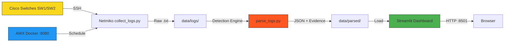

# netops-automation
Network issue detection (L2/L3 loop, MAC flapping, DNS, routing) with evidence using Netmiko &amp; Streamlit
# NetOps Automation — Issue Detection & Evidence

Detects **L2/L3 loops, MAC flapping, DNS failures & routing issues** from switch logs with evidence.

## 🏗 Architecture



## 🛠 Tech Stack

Python · Netmiko · Streamlit · Pandas · AWX · Docker · Cisco IOS

## 🚀 Quick Start

```bash
pip install -r requirements.txt

# 1. Collect logs (needs real/simulated switches)
python scripts/collect_logs.py

# 2. Parse & detect issues
python scripts/parse_logs.py

# 3. Launch dashboard
streamlit run dashboard/app.py
```

## 📊 Detection Rules

| Issue Type | Severity | Triggers |
|---|---|---|
| L2 Loop | CRITICAL | STP TCN, loop detected, port disabled |
| L3 Loop | CRITICAL | TTL expired, IP forwarding error |
| MAC Flapping | HIGH | Same MAC on multiple ports |
| DNS Issue | MEDIUM | Timeout, unreachable server |
| Routing Issue | HIGH/MEDIUM | OSPF/BGP adjacency down, interface down |

## 📁 Structure

```
├── scripts/
│   ├── collect_logs.py      # Netmiko SSH collection
│   └── parse_logs.py        # Detection engine
├── dashboard/
│   └── app.py               # Streamlit UI
├── data/
│   └── logs/                # Sample logs
├── playbooks/
│   └── 01_collect_logs.yml  # AWX playbook
├── docker-compose.yml       # AWX + Postgres
└── requirements.txt
```

## 📄 License
MIT   
